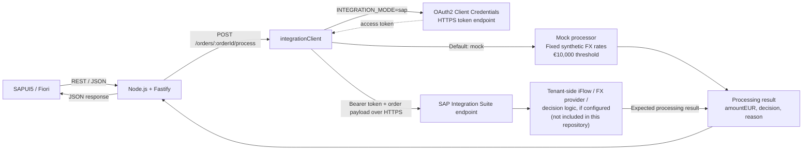

# ProcureAI

ProcureAI is a portfolio project demonstrating a procurement order workflow with a SAPUI5/Fiori control tower, a Node.js/Fastify API, and an integration-client boundary for mock or configured SAP Integration Suite processing.

**Current milestone:** the local mock flow is implemented end to end, and a real SAP Integration Suite flow has been manually validated end to end. Its iFlow source and tenant configuration live externally in SAP Integration Suite and are not stored in this repository.

## What this project demonstrates

- A browser-based purchase-order list and independently routed detail page.
- A REST API that validates order creation and owns processing and lifecycle fields.
- An integration-client abstraction that keeps mock processing and the configured SAP call behind one backend interface.
- EUR normalization and a simple approval threshold in mock mode.
- Separate processing decisions and fulfillment lifecycle status.
- Automated backend and frontend tests using Node's built-in test runner.

All included order and supplier data is synthetic. The project is a technical demo, not a production procurement or tax-compliance system.

## Architecture



The mock processor and its synthetic rates are implemented in `mock-backend/integrationClient.js`. In SAP mode, the backend obtains a token and sends a normalized order payload to the configured endpoint. The backend validates the response contract; the Integration Suite flow, external FX service, and their business rules are managed externally and are not present in this repository.

## Manually validated E2E milestone

The project owner has manually completed this live path:

```text
SAPUI5/Fiori → Fastify → integrationClient (SAP mode) → OAuth2 Client Credentials
→ SAP Integration Suite iFlow → external FX API → EUR normalization
→ approval threshold evaluation → Fastify → updated Fiori UI
```

Multiple currencies were tested successfully, including USD and CHF. This is a manual live-system validation, separate from the automated repository tests listed below. The iFlow source and tenant configuration remain in SAP Integration Suite; no tenant URLs or authentication values are published here. VAT number is optional because VIES validation is intentionally bypassed.

## End-to-end processing flow

1. Fiori loads the order list from `GET /orders`; each detail route independently requests `GET /orders/:orderId`.
2. A user can create an order through `POST /orders`. Fastify validates the supplied fields and initializes the processing result as unprocessed and the lifecycle as `CREATED`.
3. Selecting **Process Order** calls `POST /orders/:orderId/process`. Fastify passes the order to `integrationClient`.
4. In the default mock mode, the client converts supported currencies using fixed synthetic demo rates and evaluates the normalized EUR amount against a €10,000 threshold. In configured SAP mode, the client obtains an OAuth2 token and sends the order to the HTTPS endpoint.
5. The processing result contains `orderId`, `amountEUR`, `decision`, and `reason`. Fastify validates and stores the result, leaving `status` unchanged, then returns JSON to Fiori.

For example, a **15,000 USD** order in mock mode is normalized using the synthetic USD rate. Its converted amount is above the mock €10,000 threshold, so it receives `MANUAL_REVIEW`. The mock rate is demonstration data, not a live exchange quote; the resulting EUR amount is intentionally not presented here as a market value.

## Current features

- Five synthetic seed orders held in memory, plus order creation.
- Fiori list with search, decision and lifecycle filters, summary counts, refresh, loading, and error states.
- Routed order detail pages that load their own data, including direct-link and browser-refresh support.
- Processing through the mock client by default, or through the configured SAP HTTPS adapter.
- Mock conversion for EUR, USD, GBP, and PLN using fixed demo rates; results are rounded to two decimals.
- Mock decisions: `APPROVED` through €10,000 and `MANUAL_REVIEW` above €10,000. `REJECTED` is represented in the seed data and is accepted as a valid SAP-mode result; the mock processor does not generate it automatically.
- Optional VAT number display and storage. VAT/VIES validation is currently bypassed; no VIES request is implemented.
- Lifecycle values kept separate from processing decisions. Processing does not advance or cancel an order.
- Backend endpoints for recording a processing result and updating lifecycle status. These two PATCH endpoints are not exposed as actions in the current Fiori UI.
- Automated tests: nine backend cases and seven frontend detail-controller cases, covering API validation, processing behavior, routing, errors, and integration-client behavior.

## Screenshots / Demo

- **Fiori Control Tower:** screenshot pending.
- **Processed Order detail:** screenshot pending.
- **Sanitized SAP Integration Suite iFlow:** screenshot pending.

## Technology stack

| Area | Technology |
| --- | --- |
| Frontend | SAPUI5 freestyle app, `sap.m`, XML views, JSON models, UI5 Router |
| UI tooling | UI5 Tooling / `@ui5/cli` |
| Backend | Node.js 22+, Fastify 5, `@fastify/cors` |
| SAP connection adapter | HTTPS `fetch`, OAuth2 Client Credentials |
| Tests | Node.js built-in test runner (`node --test`) |

## Repository structure

```text
.
├── docs/                 # Documentation index and roadmap pointer
├── fiori/                # SAPUI5 application and detail-controller tests
├── integration-suite/    # Scope note; no iFlow artifacts are included
├── mcp-server/            # Reserved for a future MCP server
├── mock-backend/          # Fastify API, integration client, seed data, tests
└── README.md              # Current project overview and roadmap
```

More detailed setup and API notes are in [`mock-backend/README.md`](mock-backend/README.md) and [`fiori/README.md`](fiori/README.md). The integration and MCP folder READMEs describe their current status.

## API and processing contract

The backend listens on `http://127.0.0.1:3000` by default.

| Method and route | Purpose |
| --- | --- |
| `GET /health` | Basic health response. |
| `GET /orders` | Return the in-memory order list. |
| `GET /orders/:orderId` | Return one order or `404`. |
| `POST /orders` | Validate and create an order; server sets `amountEUR: null`, `decision: null`, and `status: "CREATED"`. |
| `POST /orders/:orderId/process` | Run the selected integration client; return `{ order, reason }` and store `amountEUR` and `decision`. |
| `PATCH /orders/:orderId/result` | Record a validated `amountEUR` and decision directly; API-level operation, not a Fiori action. |
| `PATCH /orders/:orderId/status` | Apply a validated lifecycle transition; API-level operation, not a Fiori action. |

Supported decisions are `APPROVED`, `MANUAL_REVIEW`, and `REJECTED`. Lifecycle status is one of `CREATED`, `CONFIRMED`, `SHIPPED`, `DELIVERED`, or `CANCELLED`. The status endpoint enforces forward fulfillment transitions and decision-dependent constraints. The separate result endpoint records the supplied result without reconciling it against lifecycle status; neither endpoint implicitly changes the other field.

New orders require an ID, supplier name, two-letter uppercase country code, positive numeric amount, and three-letter uppercase currency code. VAT number is optional. Creation inputs and processor responses are validated by the backend; extra client-supplied fields cannot override server-owned processing or lifecycle fields on creation.

## Run locally

Use Node.js 22 or newer. Install and start the backend and frontend in separate terminals from the repository root.

Terminal 1 — backend:

```sh
cd mock-backend
npm install
npm test
npm start
```

Terminal 2 — Fiori:

```sh
cd fiori
npm install
node --test test/*.test.cjs
npm start
```

Open [http://localhost:8080/](http://localhost:8080/). The Fiori app calls only the local Fastify API; it does not call SAP Integration Suite directly. Both servers use local development addresses, and Fastify allows the two Fiori origins `http://localhost:8080` and `http://127.0.0.1:8080`.

Orders and updates are held in memory. Restarting the backend discards created or updated orders and reloads the five seed examples from `mock-backend/orders.js`.

## Configuration and environment variables

The backend defaults to mock mode when `INTEGRATION_MODE` is unset. SAP mode requires all four SAP connection values below. `mock-backend/.env.example` sets mock mode and leaves the SAP-specific values blank; create a local `.env` from it and supply values through your own secure development setup. The actual `.env` is ignored by Git and must never be copied into documentation or committed.

| Variable | Purpose |
| --- | --- |
| `INTEGRATION_MODE` | `mock` (default) or `sap`. |
| `INTEGRATION_SUITE_URL` | HTTPS processing endpoint. |
| `INTEGRATION_TOKEN_URL` | HTTPS OAuth token endpoint. |
| `INTEGRATION_CLIENT_ID` | OAuth client identifier. |
| `INTEGRATION_CLIENT_SECRET` | OAuth client secret. |

SAP mode rejects missing configuration and non-HTTPS URLs. Confirm the endpoint contract with the Integration Suite owner before connecting a tenant. No tenant URL, client ID, credential, or token is required for local mock mode.

## Security design

- SAP credentials are read by the backend from environment configuration; they are not part of the Fiori app or browser requests.
- SAP mode uses HTTPS, sends client credentials to the token endpoint using OAuth2 Client Credentials, and sends the returned bearer token to the processing endpoint.
- `.env` and credential-like files are excluded by the repository ignore rules. Keep real values in a local secret store or approved runtime configuration.
- CORS is limited to the two local Fiori development origins. CORS is not authentication.
- The API currently has no user authentication or authorization. It uses synthetic data and in-memory storage and is not production-hardened.

## Mock mode and SAP mode

| | Mock mode (implemented and locally runnable) | SAP mode (manually validated E2E) |
| --- | --- | --- |
| Processing | Fixed synthetic currency rates and a local €10,000 threshold. | HTTPS request to the configured Integration Suite endpoint. |
| Authentication | None required. | OAuth2 Client Credentials; Basic authorization to the token endpoint, then bearer authorization to the processing endpoint. |
| EUR amount and decision | Calculated by the mock client. | Expected from the Integration Suite response and validated by Fastify. |
| External FX service | Not called. | External API is invoked through the tenant-side iFlow; its source and configuration are not in this repository. |
| Verification | Backend automated tests and local browser flow. | Manually validated with multiple currencies, including USD and CHF; not part of the automated repository tests. |

The SAP adapter does not silently fall back to mock processing when configuration or an upstream request fails.

## Current limitations

- The order store is in memory; there is no database or persistence layer.
- Mock FX rates are fixed synthetic values for four currencies, not current market rates.
- There is no VIES integration or VAT validation.
- The SAP E2E flow has been manually validated, but its Integration Suite iFlow source and tenant configuration are external and are not versioned in this repository.
- The mock threshold is a simplified demonstration rule. The mock emits `APPROVED` or `MANUAL_REVIEW`, not an automatic `REJECTED` decision.
- Manual review is displayed, but a human approval/rejection action is not implemented in Fiori.
- Lifecycle updates and direct result recording exist as backend endpoints but do not have Fiori actions.
- There is no authentication, audit trail, or production-grade observability and resilience layer.
- No MCP server or AI Copilot is implemented.

## Roadmap

These are future milestones, separate from the current implementation:

1. Add richer SAP Integration Suite scenarios and versioned request/response contracts.
2. Improve resilience and observability with explicit upstream timeout/retry policies, request correlation, and operational diagnostics.
3. Add an MCP server for selected procurement tools.
4. Add an AI Copilot that can explain decisions using approved project tools.
5. Add human-in-the-loop review actions and explicit decision recording.
6. Add a durable audit trail for order and decision changes.
7. Explore Clean Core patterns and a SAP BTP deployment evolution.

## Engineering decisions and lessons

- **Keep integration behind `integrationClient`.** Routes depend on a small processing contract, allowing deterministic mock mode and a separately configured SAP adapter.
- **Keep credentials out of the UI.** The browser talks to Fastify; only the backend performs OAuth and the SAP HTTPS call.
- **Separate decision from lifecycle.** A processing result describes evaluation; status describes fulfillment. Processing does not implicitly confirm or cancel an order.
- **Let the backend own computed fields.** Creation accepts business inputs, while amount normalization, decisions, and initial lifecycle values are set or validated server-side.
- **Make detail routes independently loadable.** A bookmarked order URL fetches its own data rather than depending on the list having already loaded.
- **Make the local demo deterministic.** Synthetic in-memory seed data and fixed mock rates make the workflow repeatable without SAP credentials or a live FX service.

## Data and contribution boundary

Use fictional suppliers and synthetic order data only. Do not add real company data, credentials, tokens, client identifiers, tenant names, or private SAP URLs. VIES, MCP, and AI Copilot remain outside the current implementation.
